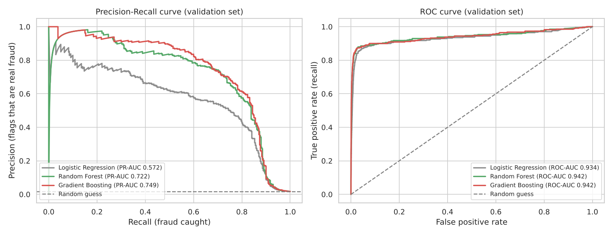
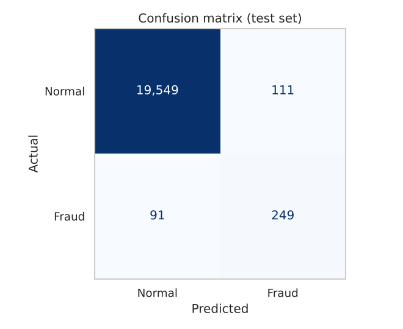
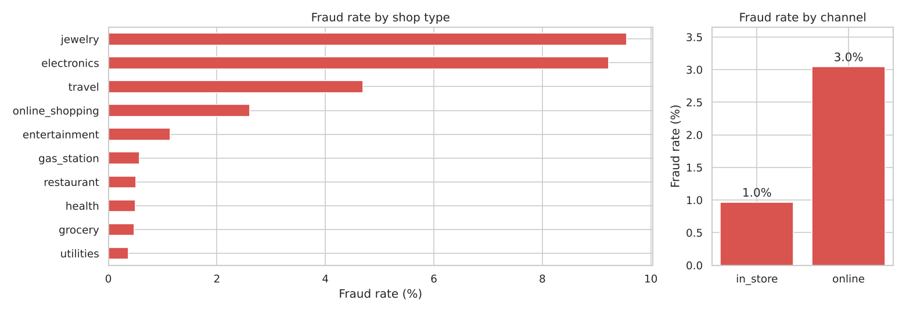
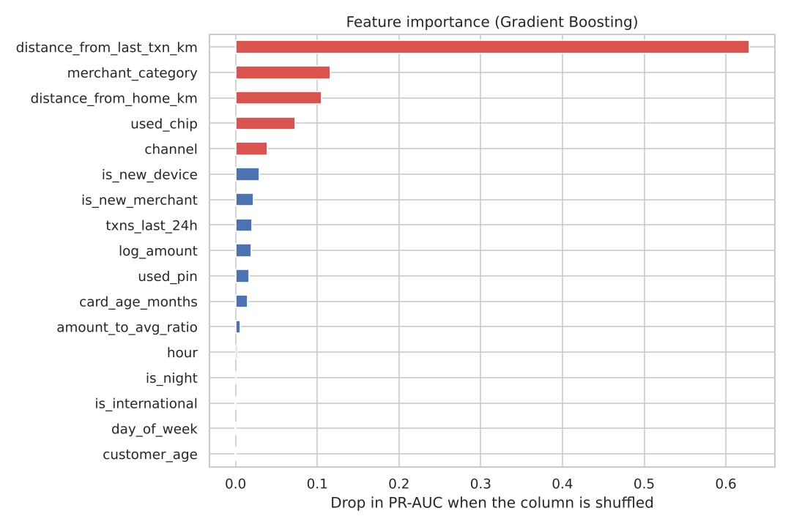

# Credit Card Fraud Detection

A machine learning project that detects fraudulent credit card transactions using Python and scikit-learn.


## The problem

Banks process millions of card transactions every day. A small number of them are fraud, and each one costs money and trust.
The challenge is that **fraud is rare**: in this dataset only **1.7%** of transactions are fraud.

Because of this, a model that always says "not fraud" is **98.3% accurate but catches no fraud at all**.
So this project measures models with **precision, recall, F1 and PR-AUC** instead of accuracy.

## Results

The final model is **Gradient Boosting** with a tuned decision threshold. Results on the **test set** (20,000 transactions the model never saw):

| Measure | Score | What it means |
|---|---|---|
| Recall | **73.2%** | Catches about 3 out of 4 fraud transactions (249 of 340) |
| Precision | **69.2%** | About 7 out of 10 flagged transactions are real fraud |
| F1 score | **0.711** | Balance of precision and recall |
| PR-AUC | **0.767** | Ranking quality for rare events (random guess = 0.017) |
| ROC-AUC | **0.942** | Overall ranking quality |
| False alarms | **0.56%** | Only 111 of 19,660 normal transactions were wrongly flagged |

**Model comparison** (validation set):

| Model | PR-AUC | ROC-AUC |
|---|---|---|
| **Gradient Boosting** | **0.749** | **0.942** |
| Random Forest | 0.722 | 0.942 |
| Logistic Regression | 0.572 | 0.934 |



<p align="center">
  
</p>

## Key findings

- **Distance from the last transaction** is the strongest warning sign. A card used far away from its last purchase is often a copied or stolen card.
- **Jewelry and electronics** have the highest fraud rates (over 9%). These items are expensive and easy to resell.
- **Online** transactions have 3× the fraud rate of in-store ones.
- Fraud is more than **4× as common at night** (12 am to 5 am) as in the daytime.
- Using the card **chip or PIN** makes fraud much less likely.





## Dataset

Real bank data is private, so this project uses a realistic **synthetic** (computer-generated) dataset of **100,000 transactions** from January to June 2025.
It is created by [`data/generate_data.py`](data/generate_data.py) and includes four common fraud patterns:

1. **Online fraud** – stolen card details used on shopping sites
2. **Card skimming** – a copied card used in a shop far from home
3. **Account takeover** – a login from a new device, followed by many quick purchases
4. **Hidden fraud** – fraud that looks just like a normal purchase

Some normal customers also behave unusually (travelling abroad, big purchases, late-night shopping), so the model cannot just learn "unusual = fraud".

| Column | Meaning |
|---|---|
| `transaction_time` | Date and time of the transaction |
| `channel` | `online` or `in_store` |
| `merchant_category` | Type of shop (grocery, electronics, travel, ...) |
| `amount` | Amount in rupees (₹) |
| `amount_to_avg_ratio` | Amount ÷ the customer's usual spending |
| `distance_from_home_km` | Distance between the shop and the customer's home |
| `distance_from_last_txn_km` | Distance from the customer's last transaction |
| `txns_last_24h` | Transactions on this card in the last 24 hours |
| `is_new_device` | 1 if an online purchase came from a new device |
| `is_new_merchant` | 1 if the customer never bought from this shop before |
| `used_chip` / `used_pin` | 1 if the chip / PIN was used (in-store only) |
| `is_international` | 1 if the transaction was in another country |
| `card_age_months`, `customer_age` | Age of the card and of the card holder |
| `is_fraud` | **Target:** 1 = fraud, 0 = normal |

## How it works

1. **Explore the data** – find patterns in amount, shop type, time and other signals
2. **Create features** – hour, day of week, a night flag, and log of the amount
3. **Split the data** – 60% train, 20% validation, 20% test (same fraud rate in each part)
4. **Train three models** – Logistic Regression, Random Forest and Gradient Boosting
5. **Choose a threshold** – pick the cut-off with the best F1 score on the validation set
6. **Test** – report final results on the test set only once, at the end
7. **Explain** – permutation importance shows which features the model relies on

The full analysis with charts and explanations is in [`Fraud_Detection.ipynb`](Fraud_Detection.ipynb).

## Project structure

```
Fraud-Detection/
├── Fraud_Detection.ipynb     # Main notebook: analysis, models and results
├── data/
│   ├── generate_data.py      # Creates the synthetic dataset
│   ├── transactions.csv      # 100,000 labelled transactions
│   └── new_transactions.csv  # 12 unlabelled transactions to test predictions
├── src/
│   ├── features.py           # Feature engineering and preprocessing (shared)
│   ├── train.py              # Trains and saves the final model
│   └── predict.py            # Checks new transactions for fraud
├── images/                   # Charts used in this README
├── models/                   # Trained model is saved here
└── requirements.txt
```

## How to run

**1. Clone the repo and install the libraries**

```bash
git clone https://github.com/Turab10/Fraud-Detection.git
cd Fraud-Detection
pip install -r requirements.txt
```

**2. Open the notebook** (to see the full analysis)

```bash
jupyter notebook Fraud_Detection.ipynb
```

**3. Train the model** (takes a few seconds)

```bash
python src/train.py
```

**4. Check new transactions for fraud**

```bash
python src/predict.py
```

Example output:

```
transaction_id  channel merchant_category   amount  fraud_probability prediction
       NEW0001 in_store           jewelry 35474.73             0.2567      FRAUD
       NEW0002 in_store        restaurant   322.40             0.0014         ok
       ...
       NEW0011   online       electronics 10898.18             0.8821      FRAUD
```

To check your own file: `python src/predict.py --input your_file.csv`. The file needs the same columns as `data/transactions.csv` (without `is_fraud`).

**Optional:** make a new dataset with `python data/generate_data.py --rows 200000`.

## Next steps

- Add customer history features (for example, spending in the last 7 days)
- Tune model settings with cross-validation
- Set the threshold using real costs (missed fraud vs. reviewing a false alarm)
- Try the same steps on a real public dataset, such as the [Kaggle credit card fraud dataset](https://www.kaggle.com/datasets/mlg-ulb/creditcardfraud)

## Tools used

Python · pandas · NumPy · scikit-learn · Matplotlib · Seaborn · Jupyter
